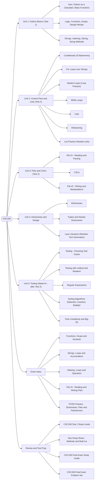

# CSC108 Map

Click any note to open it. Lessons in each unit run top to bottom in lesson order.

## Lesson links

**Unit 1: Python Basics (Test 1)**
1. [[W01 - Intro, Python as a Calculator, Basic Functions|Intro, Python as a Calculator, Basic Functions]]
2. [[W02 - Logic, Functions, Scope, Design Recipe|Logic, Functions, Scope, Design Recipe]]
3. [[W03 - Strings, Indexing, Slicing, String Methods|Strings, Indexing, Slicing, String Methods]]

**Unit 2: Control Flow and Lists (Test 2)**
1. [[W04A - Conditionals (If Statements)|Conditionals (If Statements)]]
2. [[W04B - For Loops over Strings|For Loops over Strings]]
3. [[W04C - Nested Loops (Loop Practice)|Nested Loops (Loop Practice)]]
4. [[W05A - While Loops|While Loops]]
5. [[W05B - Lists|Lists]]
6. [[W07A - Refactoring|Refactoring]]
7. [[W07B - List Practice (Nested Lists)|List Practice (Nested Lists)]]

**Unit 3: Files and CSVs (Test 2)**
1. [[W06A - File IO - Reading and Parsing|File IO - Reading and Parsing]]
2. [[W06B - CSVs|CSVs]]
3. [[W06C - File IO - Writing and Manipulations|File IO - Writing and Manipulations]]

**Unit 4: Dictionaries and Design (not on Test 2)**
1. [[W07C - Dictionaries|Dictionaries]]
2. [[W08A - Tuples and Nested Dictionaries|Tuples and Nested Dictionaries]]
3. [[W08C - Lazy Literature (Random Text Generation)|Lazy Literature (Random Text Generation)]]

**Unit 5: Testing (Week 9+, after Test 2)**
1. [[W09B - Testing - Choosing Test Cases|Testing - Choosing Test Cases]]
2. [[W09 - Testing with unittest and Mutation|Testing with unittest and Mutation]]
3. [[W09 - Regular Expressions|Regular Expressions]]
4. [[W10 - Sorting Algorithms (Selection, Insertion, Bubble)|Sorting Algorithms (Selection, Insertion, Bubble)]] (Weeks 10–11)
5. [[W11 - Time Complexity and Big-Oh|Time Complexity and Big-Oh]] (Week 11)

**Extra notes**
- [[W02 - Functions, Scope and Doctests|Functions, Scope and Doctests]]
- [[W04 - Strings, Loops and Accumulators|Strings, Loops and Accumulators]]
- [[W05 - Aliasing, Loops and Operators|Aliasing, Loops and Operators]]
- [[W06 - File IO - Reading and Writing Files|File IO - Reading and Writing Files]]
- [[W09 - PCRS Practice - Dictionaries, Files and Palindromes|PCRS Practice - Dictionaries, Files and Palindromes]]

**Review**
- [[CSC108 Test 2 Study Guide]]
- [[Test Cheat Sheet - Methods and Built-ins]]
- [[CSC108 Final Exam Study Guide]]
- [[CSC108 Final Exam Problem Set]]

## All notes (table)

![[CSC108 Hub.base]]