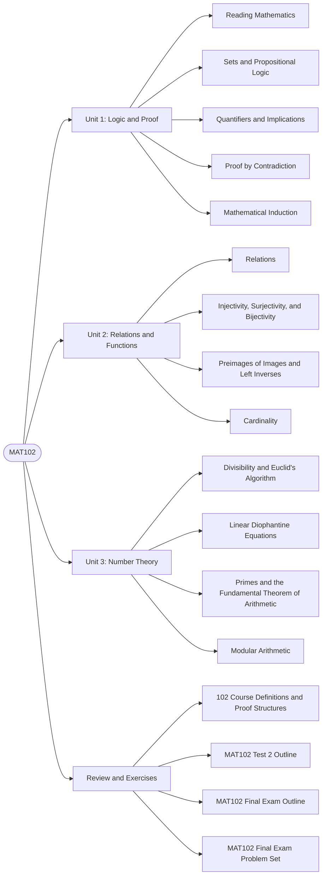

# MAT102 Map

Click any note to open it. Lessons in each unit run top to bottom in lesson order.

## Lesson links

**Unit 1: Logic and Proof**
1. [[Reading Mathematics]]
2. [[Sets and Propositional Logic]]
3. [[Quantifiers and Implications]]
4. [[Proof by Contradiction]]
5. [[Mathematical Induction]] (Reading 10, Weeks 10–11)

**Unit 2: Relations and Functions**
1. [[Relations]]
2. [[Injectivity, Surjectivity, and Bijectivity]]
3. [[Preimages of Images and Left Inverses]]
4. [[Cardinality]]

**Unit 3: Number Theory**
1. [[Divisibility and Euclid's Algorithm]]
2. [[Linear Diophantine Equations]]
3. [[Primes and the Fundamental Theorem of Arithmetic]]
4. [[Modular Arithmetic]]

**Review**
- [[102 Course Definitions and Proof Structures]]
- [[MAT102 Test 2 Outline]]
- [[MAT102 Final Exam Outline]]
- [[MAT102 Final Exam Problem Set]]

## All notes (table)

![[MAT102 Hub.base]]