# MAT137 Map

Click any note to open it. Lessons in each unit run top to bottom in lesson order.

```mermaid
flowchart LR
    C(["MAT137"])

    U1["Unit 1: Sets, Logic, Proofs"]
    U2["Unit 2: Limits and Continuity"]
    U3["Unit 3: Derivatives"]
    U4["Unit 4: Inverses, Exp/Log, Applications"]
    EX["Extra topics"]
    RV["Review and Exercises"]

    C --> U1
    C --> U2
    C --> U3
    C --> U4
    C --> EX
    C --> RV

    U1 --> a1["Sets and Notation"]
    U1 --> a2["Set-Builder Notation"]
    U1 --> a3["Logic - Negations and Proof Structure"]
    U1 --> a4["Writing Proofs"]
    U1 --> a5["Increasing Functions"]
    U1 --> a6["Proof by Induction"]

    U2 --> b1["The Idea of a Limit"]
    U2 --> b2["Epsilon-Delta Proofs"]
    U2 --> b3["Limit Laws and Existence"]
    U2 --> b4["Squeeze Theorem"]
    U2 --> b5["Continuity and Discontinuities"]
    U2 --> b6["Computing Limits"]
    U2 --> b7["EVT Extreme Value Theorem"]
    U2 --> b8["IVT Intermediate Value Theorem"]

    U3 --> c1["The Derivative - Definition and Meaning"]
    U3 --> c2["Tangent Lines and the Derivative"]
    U3 --> c3["Differentiation Rules"]
    U3 --> c4["Differentiability Implies Continuity"]
    U3 --> c5["Product and Quotient Rules"]
    U3 --> c6["Chain Rule"]
    U3 --> c7["Trigonometric Derivatives"]
    U3 --> c8["Implicit Differentiation"]
    U3 --> c9["Reading the Graph of f from f'"]

    U4 --> f1["Related Rates"]
    U4 --> f2["Inverse Functions"]
    U4 --> f3["Exponentials, Logarithms and Logarithmic Differentiation"]
    U4 --> f4["Inverse Trig - arctan"]
    U4 --> f5["Local Extrema and Critical Points"]

    EX --> d1["Bounded Times Zero Limit"]
    EX --> d2["Infinite Limits - Sum and Product"]
    EX --> d3["Codes and Asymptotic Regularity"]
    EX --> d4["2SA3 - Strong and Shrinking Functions (Uniform Continuity and Lipschitz)"]
    EX --> d5["Limit Law Proofs from the Definition"]
    U4 --> f6["Functions - Domain, Codomain and Range"]
    U4 --> f7["Rolle's Theorem and the Mean Value Theorem"]
    U4 --> f8["Applied Optimization"]
    U4 --> f9["L'Hôpital's Rule and Indeterminate Forms"]
    RV --> e5["Week 10 Tutorial Problems"]

    RV --> e1["137 Course Definitions and Proof Structures"]
    RV --> e2["2SA2 Exercise Questions"]
    RV --> e3["MAT137 Theorems"]
    RV --> e4["MAT137 Test 2 Study Guide"]
    RV --> e6["MAT137 Final Exam Study Guide"]
    RV --> e7["MAT137 Final Exam Problem Set"]

    class a1,a2,a3,a4,a5,a6,b1,b2,b3,b4,b5,b6,b7,b8,c1,c2,c3,c4,c5,c6,c7,c8,c9,f1,f2,f3,f4,f5,d1,d2,d3,d4,d5,f6,f7,f8,f9,e1,e2,e3,e4,e5,e6,e7 internal-link
```

## Lesson links

**Unit 1: Sets, Logic, Proofs**
1. [[Sets and Notation]]
2. [[Set-Builder Notation]]
3. [[Logic - Negations and Proof Structure]]
4. [[Writing Proofs]]
5. [[Increasing Functions]]
6. [[Proof by Induction]]

**Unit 2: Limits and Continuity**
1. [[The Idea of a Limit]]
2. [[Epsilon-Delta Proofs]]
3. [[Limit Laws and Existence]]
4. [[Squeeze Theorem]]
5. [[Continuity and Discontinuities]]
6. [[Computing Limits]]
7. [[EVT Extreme Value Theorem]]
8. [[IVT Intermediate Value Theorem]]

**Unit 3: Derivatives**
1. [[The Derivative - Definition and Meaning]]
2. [[Tangent Lines and the Derivative]]
3. [[Differentiation Rules]]
4. [[Differentiability Implies Continuity]]
5. [[Product and Quotient Rules]]
6. [[Chain Rule]]
7. [[Trigonometric Derivatives]]
8. [[Implicit Differentiation]]
9. [[Reading the Graph of f from f']]

**Unit 4: Inverses, Exp/Log, Applications** (Weeks 8–9)
1. [[Related Rates]]
2. [[Functions - Domain, Codomain and Range]]
3. [[Inverse Functions]]
4. [[Exponentials, Logarithms and Logarithmic Differentiation]]
5. [[Inverse Trig - arctan]]
6. [[Local Extrema and Critical Points]]
7. [[Rolle's Theorem and the Mean Value Theorem]]
8. [[Applied Optimization]] (Week 11)
9. [[L'Hôpital's Rule and Indeterminate Forms]] (Week 11)

**Extra topics**
- [[Bounded Times Zero Limit]]
- [[Infinite Limits - Sum and Product]]
- [[Codes and Asymptotic Regularity]]
- [[2SA3 - Strong and Shrinking Functions (Uniform Continuity and Lipschitz)]]
- [[Limit Law Proofs from the Definition]]

**Review**
- [[137 Course Definitions and Proof Structures]]
- [[MAT137 Theorems]]
- [[2SA2 Exercise Questions]]
- [[MAT137 Test 2 Study Guide]]
- [[Week 10 Tutorial Problems]]
- [[MAT137 Final Exam Study Guide]]
- [[MAT137 Final Exam Problem Set]]

## All notes (table)

![[MAT137 Hub.base]]