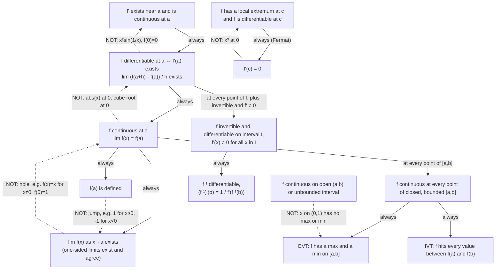

# 137 Course Definitions, Theorems and Proof Structures

Related: [[W04 - Epsilon-Delta Proofs|Epsilon-Delta Proofs]] · [[W01 - Logic - Negations and Proof Structure|Logic - Negations and Proof Structure]]

Quick-reference sheet: every definition, proof structure and theorem in one place. Worked proofs are in the linked concept notes.

## Contents

**Definitions and proof structures**
- [[#Limit definitions (memorize exactly)|Limit definitions]]
- [[#Negation of the limit statement|Negation of the limit statement]]
- [[#Increasing (Playlist 1, Video 1.10)|Increasing]]
- [[#Continuity and derivative (Playlists 2–3)|Continuity, derivative, maximum]]
- [[#Proof structure|Proof structure]]
- [[#Tools|Tools]]

**Theorems**
- [[#Proof warm-ups|Proof warm-ups]]
	- [[#AM-GM inequality|AM-GM inequality]]
	- [[#Sum of increasing functions|Sum of increasing functions]]
	- [[#Sum of the first n integers|Sum of the first n integers]]
- [[#Limits|Limits]]
	- [[#Limit laws|Limit laws]]
	- [[#Basic limits|Basic limits]]
	- [[#Side limits|Side limits]]
	- [[#Squeeze Theorem|Squeeze Theorem]]
	- [[#Bounded times zero|Bounded times zero]]
	- [[#Fundamental trig limits|Fundamental trig limits]]
	- [[#Infinite limits, sum and product|Infinite limits, sum and product]]
	- [[#Limit of a composition|Limit of a composition]]
- [[#Continuity|Continuity]]
	- [[#Main Continuity Theorem|Main Continuity Theorem]]
	- [[#Composition of continuous functions|Composition of continuous functions]]
	- [[#Intermediate Value Theorem (IVT)|Intermediate Value Theorem (IVT)]]
	- [[#Extreme Value Theorem (EVT)|Extreme Value Theorem (EVT)]]
- [[#Derivatives|Derivatives]]
	- [[#Differentiable implies continuous|Differentiable implies continuous]]
	- [[#Flowchart: limits, continuity, derivatives|Flowchart: limits, continuity, derivatives]]
	- [[#Sum, constant multiple and quotient rules|Sum, constant multiple and quotient rules]]
	- [[#Product rule|Product rule]]
	- [[#Power rule|Power rule]]
	- [[#Chain rule|Chain rule]]
	- [[#Derivatives of the basic functions|Derivatives of the basic functions]]
- [[#Inverse functions|Inverse functions]]
	- [[#Inverses and bijections|Inverses and bijections]]
	- [[#Composition of injective functions|Composition of injective functions]]
	- [[#Inverse Function Theorem|Inverse Function Theorem]]
- [[#Extrema|Extrema]]
	- [[#Fermat's theorem (local EVT)|Fermat's theorem (local EVT)]]
	- [[#Rolle's theorem|Rolle's theorem]]
	- [[#Closed-interval method|Closed-interval method]]

---

# Definitions and proof structures

## Limit definitions (memorize exactly)

**Limit:**

$$\lim_{x\to a} f(x)=L \iff \forall \varepsilon>0,\ \exists \delta>0,\ \forall x,\ 0<|x-a|<\delta \Rightarrow |f(x)-L|<\varepsilon$$

**Right-hand:**

$$\lim_{x\to a^+} f(x)=L \iff \forall \varepsilon>0,\ \exists \delta>0,\ \forall x,\ a<x<a+\delta \Rightarrow |f(x)-L|<\varepsilon$$

**Left-hand:** same with

$$a-\delta<x<a$$

**Infinite limit:**

$$\lim_{x\to a} f(x)=+\infty \iff \forall M,\ \exists \delta>0,\ \forall x,\ 0<|x-a|<\delta \Rightarrow f(x)>M$$

**At infinity:**

$$\lim_{x\to +\infty} f(x)=L \iff \forall \varepsilon>0,\ \exists N,\ \forall x,\ x>N \Rightarrow |f(x)-L|<\varepsilon$$

**Two-sided:**

$$\lim_{x\to a} f(x)=L \iff \lim_{x\to a^-} f(x)=L\ \text{ and }\ \lim_{x\to a^+} f(x)=L$$

## Negation of the limit statement

$$\lim_{x\to a} f(x)\neq L \iff \exists \varepsilon>0,\ \forall \delta>0,\ \exists x,\ 0<|x-a|<\delta \ \wedge\ |f(x)-L|\ge\varepsilon$$

The limit **does not exist** when this holds **for every** $L$.

## Increasing (Playlist 1, Video 1.10)

$f$ is increasing on an interval $I$:

$$\forall x_1,x_2\in I,\ \big(x_1<x_2\Rightarrow f(x_1)<f(x_2)\big)$$

Not increasing on $I$:

$$\exists x_1,x_2\in I,\ \big(x_1<x_2\ \wedge\ f(x_1)\ge f(x_2)\big)$$

See [[W02 - Increasing Functions|Increasing Functions]].

## Continuity and derivative (Playlists 2–3)

**Continuous at $a$:**

$$\lim_{x\to a}f(x)=f(a)\iff\forall\varepsilon>0\ \exists\delta>0\ \forall x,\ |x-a|<\delta\Rightarrow|f(x)-f(a)|<\varepsilon$$

**Limit does not exist (at $\infty$):**

$$\forall L\ \exists\varepsilon>0\ \forall M\ \exists x:\ x>M\wedge|f(x)-L|\ge\varepsilon$$

**Derivative** ($f$ is differentiable at $a$ iff this limit exists):

$$f'(a)=\lim_{x\to a}\frac{f(x)-f(a)}{x-a}=\lim_{h\to0}\frac{f(a+h)-f(a)}{h}$$

**Maximum on $I$:**

$$\exists c\in I\ \forall x\in I,\ f(x)\le f(c)$$

See [[W05 - Continuity and Discontinuities|Continuity and Discontinuities]] · [[W06 - The Derivative - Definition and Meaning|The Derivative - Definition and Meaning]].

## Proof structure

- $\forall x\,P(x)$: **"Let $x$ be arbitrary..."**, then **prove $P(x)$**
- $\exists x\,P(x)$: **"Choose $x=\dots$"**, then **verify**
- $A\Rightarrow B$: **direct** (**assume $A$**, **show $B$**), **contrapositive** ($\neg B\Rightarrow\neg A$), or **contradiction**
- $\varepsilon$-$\delta$ skeleton: **Let $\varepsilon>0$.** **Choose $\delta=\dots$** (found in scratch work). **Let $x$ satisfy $0<|x-a|<\delta$.** **Then $\dots<\varepsilon$.**
- Quantifier order dictates dependence: $\delta$ may depend on $\varepsilon$ (and $a$), but not on $x$.

## Tools

- $|x-y|$ is the distance between $x$ and $y$
- Triangle inequality:
$$|a+b|\le |a|+|b|\qquad\big||a|-|b|\big|\le |a-b|$$
- Typical trick: bound $|x|$ by restricting $\delta\le 1$, then take $\delta=\min\{1,\dots\}$

[[#Contents|↑ Back to contents]]

---

# Theorems

**Proved** = proved in class or a video, so know the argument. **Given** = taken without proof in MAT137. On tests you may cite any of these without proof, unless the question asks you to prove that result.

## Proof warm-ups

### AM-GM inequality

*Proved, Video 1.9.* For all $x,y\ge0$:

$$\sqrt{xy}\le\frac{x+y}{2}$$

See [[W02 - Writing Proofs|Writing Proofs]].

### Sum of increasing functions

*Proved, Video 1.13.* If $f$ and $g$ are increasing on an interval $I$, then $f+g$ is increasing on $I$.

See [[W02 - Increasing Functions|Increasing Functions]].

### Sum of the first n integers

*Proved by induction, Video 1.15.* For every positive integer $n$:

$$1+2+\dots+n=\frac{n(n+1)}{2}$$

See [[W02 - Proof by Induction|Proof by Induction]].

[[#Contents|↑ Back to contents]]

## Limits

### Limit laws

*Sum law proved, Video 2.10.* If $\lim_{x\to a}f(x)=L$ and $\lim_{x\to a}g(x)=M$, **both real numbers**, then

$$\lim_{x\to a}(f+g)=L+M\qquad\lim_{x\to a}(fg)=LM\qquad\lim_{x\to a}\frac fg=\frac LM\ \ (M\ne0)$$

These are if-then statements only. If a limit doesn't exist, the laws say nothing.

See [[W04 - Limit Laws and Existence|Limit Laws and Existence]], and [[W04 - Epsilon-Delta Proofs|Epsilon-Delta Proofs]] for the sum-law proof.

### Basic limits

*Proved from the definition.*

$$\lim_{x\to a}x=a\qquad\lim_{x\to a}c=c$$

With the limit laws, these give: limits of polynomials are found by plugging in.

### Side limits

*Videos 2.2–2.3.*

$$\lim_{x\to a}f(x)=L\iff\lim_{x\to a^-}f(x)=L\ \text{ and }\ \lim_{x\to a^+}f(x)=L$$

So if the one-sided limits differ, the limit does not exist.

See [[W03 - The Idea of a Limit|The Idea of a Limit]].

### Squeeze Theorem

*Proved, Video 2.13.* Let $a,L\in\mathbb R$. If there is $p>0$ with

$$0<|x-a|<p\Rightarrow h(x)\le g(x)\le f(x)$$

and

$$\lim_{x\to a}h(x)=\lim_{x\to a}f(x)=L$$

then

$$\lim_{x\to a}g(x)=L$$

See [[W04 - Squeeze Theorem|Squeeze Theorem]].

### Bounded times zero

*Proved.* If $\lim_{x\to a}f(x)=0$ and $g$ is bounded near $a$ (there is $M>0$ with $|g(x)|\le M$ for $x$ near $a$, $x\ne a$), then

$$\lim_{x\to a}f(x)\,g(x)=0$$

See [[W04 - Bounded Times Zero Limit|Bounded Times Zero Limit]].

### Fundamental trig limits

*Proved, Video 2.18.*

$$\lim_{x\to0}\frac{\sin x}{x}=1\qquad\lim_{x\to0}\frac{\cos x-1}{x}=0$$

The first comes from the Squeeze Theorem and a unit-circle area argument, not L'Hôpital (that would be circular).

See [[W04 - Squeeze Theorem|Squeeze Theorem]] and [[W05 - Computing Limits|Computing Limits]].

### Infinite limits, sum and product

*Proved, 2SA2.* Let $f,g$ be positive with domain $\mathbb R$, and

$$\lim_{x\to a}f(x)=\infty$$

- If $\lim_{x\to a}g(x)$ exists, then $\lim_{x\to a}(f+g)=\infty$.
- If $\lim_{x\to a}g(x)=L$ with $L>0$, then $\lim_{x\to a}fg=\infty$.

See [[W03 - Infinite Limits - Sum and Product|Infinite Limits - Sum and Product]].

### Limit of a composition

*Proved, Week 5 slides.* If $\lim_{x\to a}f(x)=L$ and $g$ is **continuous at $L$**, then

$$\lim_{x\to a}g(f(x))=g(L)$$

Alternative hypothesis: $\lim_{y\to L}g(y)=M$ **and** $f(x)\ne L$ for $x$ near $a$, $x\ne a$. Then

$$\lim_{x\to a}g(f(x))=M$$

Without one of these extra hypotheses, the result is false.

See [[W04 - Limit Laws and Existence|Limit Laws and Existence]] and [[W05 - Continuity and Discontinuities|Continuity and Discontinuities]].

[[#Contents|↑ Back to contents]]

## Continuity

### Main Continuity Theorem

*Proof plan, Video 2.15.* Every function built with $+,\ \times,\ \div,\ \circ$ from polynomials, roots, trig functions, exponentials, logs and $|x|$ is **continuous on its domain**. Inside the domain, you can find limits by plugging in.

See [[W05 - Continuity and Discontinuities|Continuity and Discontinuities]].

### Composition of continuous functions

*Video 2.16.* If $f$ is continuous at $a$ and $g$ is continuous at $f(a)$, then $g\circ f$ is continuous at $a$.

### Intermediate Value Theorem (IVT)

*Given, Video 2.22.* If $f$ is **continuous on $[a,b]$**, then for every $M$ between $f(a)$ and $f(b)$:

$$\exists c\in[a,b],\ f(c)=M$$

It gives existence only, not uniqueness.

See [[W06 - IVT Intermediate Value Theorem|IVT Intermediate Value Theorem]].

### Extreme Value Theorem (EVT)

*Given, Video 2.21.* If $f$ is continuous on a **closed, bounded** interval $[a,b]$, then there are $c,d\in[a,b]$ with

$$f(d)\le f(x)\le f(c)\quad\text{for all }x\in[a,b]$$

See [[W06 - EVT Extreme Value Theorem|EVT Extreme Value Theorem]].

[[#Contents|↑ Back to contents]]

## Derivatives

### Differentiable implies continuous

*Proved.* If $f$ is differentiable at $c$, then $f$ is continuous at $c$.

The converse is false ($|x|$ at $0$). Contrapositive: discontinuous at $c$ ⇒ not differentiable at $c$.

See [[W06 - Differentiability Implies Continuity|Differentiability Implies Continuity]].

### Flowchart: limits, continuity, derivatives

Solid arrows always hold. Dotted arrows are **false** converses, labelled with a counterexample.

**Continuous at $a$ means three things at once:**

$$f(a)\text{ is defined}\quad\text{and}\quad\lim_{x\to a}f(x)\text{ exists}\quad\text{and}\quad\lim_{x\to a}f(x)=f(a)$$

Missing any one gives a discontinuity:
- **removable:** the limit exists but $\ne f(a)$, or $f(a)$ is undefined;
- **jump:** the one-sided limits exist but differ;
- **infinite / oscillating:** a one-sided limit is $\pm\infty$ or doesn't exist.

**Contrapositives** (use these to prove something *fails*):

$$\lim_{x\to a}f(x)\text{ DNE}\implies f\text{ not continuous at }a\implies f\text{ not differentiable at }a$$

**For IVT, EVT and the inverse function theorem, check the hypotheses every time:** closed, bounded, continuous on the whole interval; $f'\ne0$.

**Counterexamples worth memorizing:**

| Claim (false) | Counterexample |
|---|---|
| continuous ⇒ differentiable | $\lvert x\rvert$ at $0$, $\sqrt[3]x$ at $0$ |
| limit exists ⇒ continuous | $f(x)=x$ for $x\ne0$, $f(0)=1$ |
| defined at $a$ ⇒ limit exists | jump function; $\sin\frac1x$ with $f(0)=0$ |
| differentiable everywhere ⇒ $f'$ continuous | $x^2\sin\frac1x$, $f(0)=0$ |
| continuous at $a$ ⇒ continuous near $a$ | $x^2\chi_{\mathbb Q}$ (continuous and even differentiable **only** at $0$) |
| continuous on an open interval ⇒ has a max | $x$ or $\frac1x$ on $(0,1)$ |
| $f'(c)=0$ ⇒ local extremum | $x^3$ at $0$ |
| $f$ differentiable and invertible ⇒ $f^{-1}$ differentiable | $x^3$: $f^{-1}=\sqrt[3]x$ fails at $0$, because $f'(0)=0$ |

### Sum, constant multiple and quotient rules

*Video 3.4.* If $f,g$ are differentiable at $a$, then so are $f+g$, $cf$, and $\frac fg$ (when $g(a)\ne0$):

$$(f+g)'=f'+g'\qquad(cf)'=c\,f'\qquad\left(\frac fg\right)'=\frac{f'g-fg'}{g^2}$$

See [[W06 - Differentiation Rules|Differentiation Rules]] and [[W07 - Product and Quotient Rules|Product and Quotient Rules]].

### Product rule

*Proved, Video 3.6.* If $f,g$ are differentiable at $a$, then $fg$ is differentiable at $a$ and

$$(fg)'(a)=f'(a)\,g(a)+f(a)\,g'(a)$$

See [[W07 - Product and Quotient Rules|Product and Quotient Rules]].

### Power rule

*Proved for positive integers by induction (Video 3.7), for all real exponents in Video 4.10.* For $x>0$ and any real $c$ (all $x$ when $c$ is a positive integer):

$$\left(x^c\right)'=c\,x^{c-1}$$

See [[W06 - Differentiation Rules|Differentiation Rules]] and [[W08 - Exponentials, Logarithms and Logarithmic Differentiation|Exponentials, Logarithms and Logarithmic Differentiation]].

### Chain rule

*Video 3.11.* If $g$ is differentiable at $a$ **and** $f$ is differentiable at $g(a)$, then $f\circ g$ is differentiable at $a$ and

$$(f\circ g)'(a)=f'\big(g(a)\big)\,g'(a)$$

The "multiply and divide by $g(x)-g(a)$" proof has a gap.

See [[W07 - Chain Rule|Chain Rule]].

### Derivatives of the basic functions

*Videos 3.12, 4.7, 4.8.*

$$(\sin x)'=\cos x\qquad(\cos x)'=-\sin x\qquad(e^x)'=e^x\qquad(\ln x)'=\frac1x$$

$$\left(a^x\right)'=a^x\ln a\qquad\left(\log_a x\right)'=\frac{1}{x\ln a}$$

See [[W07 - Trigonometric Derivatives|Trigonometric Derivatives]] and [[W08 - Exponentials, Logarithms and Logarithmic Differentiation|Exponentials, Logarithms and Logarithmic Differentiation]].

[[#Contents|↑ Back to contents]]

## Inverse functions

### Inverses and bijections

*Week 8.* $f$ has an inverse $\iff$ $f$ is bijective. Under the calculus convention (codomain = range), this becomes: $f$ has an inverse $\iff$ $f$ is injective.

See [[W08 - Inverse Functions|Inverse Functions]].

### Composition of injective functions

*Proved.* If $f$ and $g$ are injective, then $f\circ g$ is injective. The converse is false, but if $f\circ g$ is injective, then $g$ is injective.

### Inverse Function Theorem

*Video 4.4.* Let $f$ be defined on an interval $I$. If $f$ is invertible, differentiable, and $f'(x)\ne0$ for all $x\in I$, then $f^{-1}$ is differentiable. With $f(a)=b$:

$$\left(f^{-1}\right)'(b)=\frac{1}{f'(a)}=\frac{1}{f'\!\left(f^{-1}(b)\right)}$$

See [[W08 - Inverse Functions|Inverse Functions]] and [[W09 - Inverse Trig - arctan|Inverse Trig - arctan]].

[[#Contents|↑ Back to contents]]

## Extrema

### Fermat's theorem (local EVT)

*Week 9.* If $f$ has a local extremum at $c$, then $f'(c)=0$ or $f$ is not differentiable at $c$. In other words, every local extremum is at a critical point.

The converse is false ($x^3$ at $0$).

See [[W09 - Local Extrema and Critical Points|Local Extrema and Critical Points]].

### Rolle's theorem

*Week 9.* If $f$ is continuous on $[a,b]$, differentiable on $(a,b)$, and $f(a)=f(b)$, then

$$\exists c\in(a,b),\ f'(c)=0$$

Between any two roots of $f$ there is a root of $f'$.

See [[W09 - Local Extrema and Critical Points|Local Extrema and Critical Points]].

### Closed-interval method

If $f$ is continuous on $[a,b]$, its global max and min exist (by EVT). Each one is at a critical point or at an endpoint.

[[#Contents|↑ Back to contents]]
